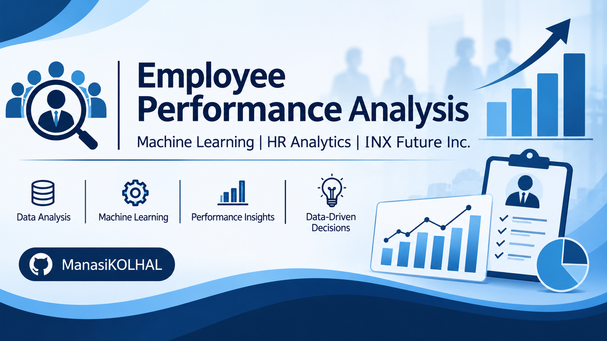
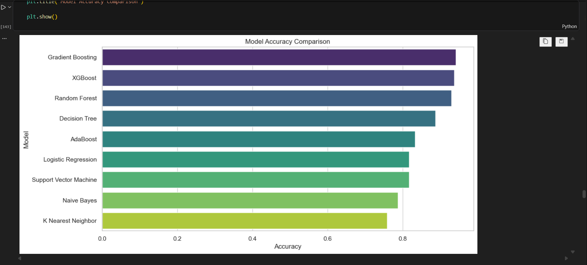

# Employee Performance Analysis & Prediction – INX Future Inc.

### IABAC Certified Data Scientist (CDS) Capstone Project

**Author:** Manasi Kolhal  
**Domain:** Human Resource Analytics | Data Science | Machine Learning  
**Methodology:** CRISP-DM  
**Problem Type:** Multi-Class Classification  
**Target Variable:** `PerformanceRating`

---

## 1. Project Overview

Employee performance is an important factor influencing organizational productivity, operational efficiency, and business growth.

INX Future Inc., a Data Analytics and Automation Solution Provider, identified a decline in its Employee Performance Index, an 8% reduction in client satisfaction, and an increase in service delivery escalations.

This project applies data analytics and machine learning techniques to analyze employee performance, identify important performance-related factors, and develop predictive models to support data-driven Human Resource (HR) decision-making.

The project follows the CRISP-DM methodology and includes exploratory data analysis, statistical analysis, feature engineering, machine learning, model evaluation, explainability, and business recommendations.

## 2. Business Objectives

- Analyze employee performance across different departments.
- Identify the top three factors influencing employee performance.
- Develop machine learning models to predict employee performance ratings.
- Identify employees who may require additional support or development.
- Provide recommendations for improving workforce productivity.
- Support data-driven HR planning and decision-making.

## 3. Dataset Description

The project uses the Employee Performance dataset provided for the INX Future Inc. business scenario as part of the DataMites training project.

| Dataset Attribute | Description |
|---|---|
| Records | 1,200 |
| Original columns | 28 |
| Target variable | PerformanceRating |
| Problem type | Multi-Class Classification |
| Domain | Human Resource Analytics |

The dataset includes employee demographics, education, department, job role, compensation, workplace satisfaction, career progression, work experience, attrition status, and performance ratings.

**Target variable:** `PerformanceRating`

The target contains three performance rating classes: 2, 3, and 4.

The employee identifier `EmpNumber` is removed during data preparation and is not used as a predictive feature.

**Dataset availability:** The original dataset is not included in this repository. It was provided as part of DataMites training. Users must obtain an authorized copy separately.

## 4. Project Methodology – CRISP-DM

The project follows six phases of the CRISP-DM methodology:

1. **Business Understanding:** Identify organizational challenges and define project objectives.
2. **Data Understanding:** Inspect the dataset, assess data quality, and understand employee attributes.
3. **Data Preparation:** Handle data quality issues, perform feature engineering, encode categorical variables, and prepare model inputs.
4. **Modeling:** Train and compare nine supervised machine learning algorithms.
5. **Evaluation:** Compare model performance using classification metrics, cross-validation, confusion matrices, and feature importance.
6. **Deployment (Conceptual):** Present model findings and business recommendations for potential HR decision-support applications.

## 5. Exploratory Data Analysis

The analysis covers:

- Employee demographics and education.
- Department-wise performance.
- Job role-wise performance.
- Workplace and job satisfaction.
- Compensation and salary increments.
- Employee experience and career progression.
- Work-life balance.
- Attrition patterns.
- Statistical relationships between employee attributes and performance ratings.

Data visualization and statistical analysis are used to identify patterns and support business interpretation.

## 6. Machine Learning Algorithms

Nine classification algorithms are evaluated:

1. Logistic Regression
2. Decision Tree Classifier
3. Random Forest Classifier
4. Gradient Boosting Classifier
5. XGBoost Classifier
6. AdaBoost Classifier
7. Support Vector Machine (SVM)
8. K-Nearest Neighbors (KNN)
9. Gaussian Naive Bayes

Hyperparameter tuning is performed for:

- Random Forest
- XGBoost
- Gradient Boosting

The dataset is divided into training and testing sets using an 80:20 split with stratification and `random_state=42`.

## 7. Model Evaluation

Models are evaluated using:

- Accuracy
- Weighted Precision
- Weighted Recall
- Weighted F1-Score
- Cross-Validation
- Confusion Matrix
- Classification Report
- Multi-class ROC-AUC

### Final Model: Gradient Boosting Classifier

The tuned Gradient Boosting Classifier was selected as the final predictive model.

**Recorded test-set performance:**

| Evaluation Metric | Score |
|---|---:|
| Accuracy | 94.17% |
| Weighted Precision | 94.44% |
| Weighted Recall | 94.17% |
| Weighted F1-Score | 93.96% |

These results are from the saved notebook's tuned Gradient Boosting model evaluation on the 240-record test set.

*Note: Cross-validation in the current notebook is calculated on the full dataset in a later cell. It should be recalculated using training data only before reporting an independent cross-validation result.*

## 8. Feature Importance and Explainability

Feature importance analysis from the final Gradient Boosting model identified the following three leading predictive features:

| Rank | Feature | Importance |
|---|---|---:|
| 1 | EmpEnvironmentSatisfaction | 0.2442 |
| 2 | EmpLastSalaryHikePercent | 0.2345 |
| 3 | YearsSinceLastPromotion | 0.1838 |

### Business Interpretation

- **Work Environment Satisfaction:** Highlights the importance of a supportive and engaging workplace.
- **Salary Hike Percentage:** Represents compensation growth and reward-related factors.
- **Years Since Last Promotion:** Highlights the potential relevance of career progression opportunities.

Feature importance represents predictive contribution, not proof of causation.

The notebook also includes a SHAP explainability section.

## 9. Business Recommendations

Based on the analysis, the project proposes the following HR strategies:

- Improve workplace satisfaction and employee engagement.
- Introduce transparent salary revision policies.
- Establish structured career development and promotion programs.
- Provide targeted employee training and mentoring.
- Conduct regular performance reviews and feedback sessions.
- Strengthen employee recognition and retention initiatives.
- Use predictive analytics as a decision-support tool for HR planning.

## 10. Technology Stack

| Category | Technologies |
|---|---|
| Programming Language | Python |
| Data Analysis | Pandas, NumPy |
| Visualization | Matplotlib, Seaborn |
| Statistical Analysis | SciPy, Statsmodels |
| Machine Learning | Scikit-learn, XGBoost |
| Explainable AI | SHAP |
| Model Persistence | Joblib |
| Development Environment | Jupyter Notebook |

## 11. Repository Structure

```text
employee-performance-analysis/
│
├── EMPLOYEE_PERFORMANCE_ANALYSIS.ipynb
├── README.md
├── requirements.txt
├── .gitignore
│
└── screenshots/
```

The screenshots folder can be added when project visualizations and results are prepared for display.

## 12. How to Run the Project

### Prerequisites

- Python 3.10 or a compatible Python environment
- Jupyter Notebook
- An authorized copy of the project dataset

### Step 1: Clone the repository

```bash
git clone YOUR_GITHUB_REPOSITORY_URL
```

### Step 2: Navigate to the project folder

```bash
cd employee-performance-analysis
```

### Step 3: Create a virtual environment

```bash
python -m venv venv
```

### Step 4: Activate the environment

Windows:

```bash
venv\Scripts\activate
```

### Step 5: Install dependencies

```bash
python -m pip install --upgrade pip
pip install -r requirements.txt
```

### Step 6: Place the dataset

Obtain an authorized copy of the dataset and place it in the project directory using the filename expected by the notebook:

`INX_Future_Inc_Employee_Performance_CDS_Project2_Data_V1.8.xls`

### Step 7: Launch Jupyter Notebook

```bash
jupyter notebook
```

### Step 8: Run the notebook

Open `EMPLOYEE_PERFORMANCE_ANALYSIS.ipynb` and execute the cells sequentially.

## 13. Model Saving and Prediction

The notebook demonstrates model persistence using Joblib.

The model and preprocessing objects are saved as:

- `gradient_boosting_employee_performance_model.pkl`
- `employee_scaler.pkl`
- `employee_label_encoders.pkl`
- `standard_scaler.pkl`
- `label_encoders.pkl`

These files are generated when the relevant notebook cells are executed. They are not required to be committed to GitHub for the initial project upload.

The notebook also demonstrates prediction on new employee records.

## 14. Model Limitations and Ethical Considerations

- The model relies on historical employee data.
- Additional organizational factors may influence employee performance but are not included in the dataset.
- Feature importance indicates predictive association, not causation.
- Predictions should support, not replace, human HR decisions.
- Employee-related predictions require careful consideration of privacy, fairness, and potential bias.
- Model performance should be validated periodically before real-world use.
- The model has not been established as a production HR system.

## 15. Future Scope

- Develop an interactive HR analytics dashboard.
- Integrate the model with an HR Management System.
- Improve SHAP-based explainability.
- Incorporate additional employee engagement and attendance information.
- Explore advanced machine learning techniques.
- Implement periodic model validation and retraining.

## 16. Conclusion

This project demonstrates the application of data analytics and machine learning to employee performance analysis.

Nine classification algorithms were evaluated, and the tuned Gradient Boosting Classifier was selected as the final model, achieving 94.17% accuracy on the recorded test set.

The feature importance analysis identified workplace environment satisfaction, salary hike percentage, and years since last promotion as the three leading predictive factors.

The project demonstrates practical skills in Python, exploratory data analysis, feature engineering, machine learning, model evaluation, explainability, and business-oriented analytical recommendations.

---

## Model Comparison



## Key Results

- **Best Performing Model:** Gradient Boosting Classifier
- **Test Accuracy:** 94.17%
- **Weighted Precision:** 94.44%
- **Weighted Recall:** 94.17%
- **Weighted F1-Score:** 93.96%

### Top Important Features

1. Employee Environment Satisfaction
2. Employee Last Salary Hike Percentage
3. Years Since Last Promotion
---

## Author

**Manasi Kolhal**  
IABAC Certified Data Scientist (CDS)

**Project:** Employee Performance Analysis – INX Future Inc.  
**Domain:** Data Science | Machine Learning | HR Analytics
